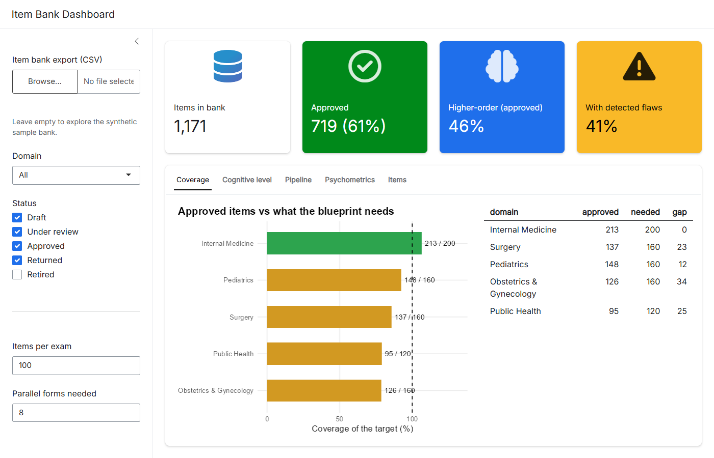
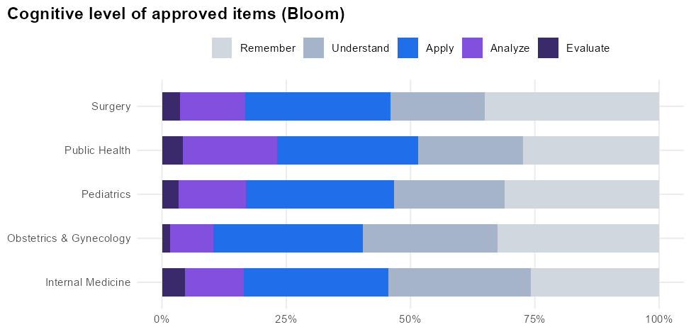
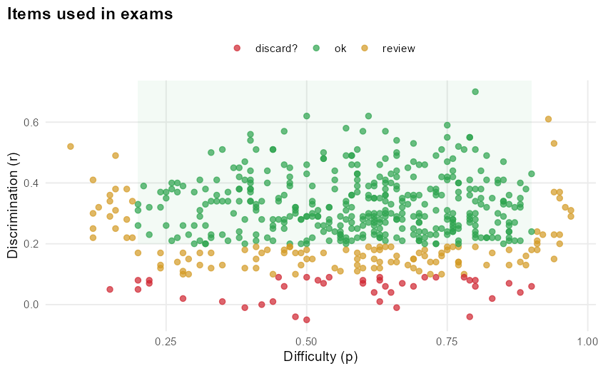

# Item Bank Dashboard


> An interactive R Shiny dashboard to audit a test item bank: **is it big enough,
> balanced enough and good enough** to assemble the exams we need?

Item banks grow organically — authors write what they know, reviewers approve
what reaches them — and nobody sees the whole picture until an exam cannot be
assembled. This dashboard reads an item-bank export and answers the questions
a coordinator needs before the next exam cycle.

<p align="center">
  
</p>

## ✨ What it shows

| Tab | Question it answers |
|---|---|
| **KPIs** | How many items are approved? What share tests higher-order thinking? How many have detected flaws? |
| **Coverage** | For *N* parallel forms of *k* items, which domains are short, and by how many items? |
| **Cognitive level** | Is the bank dominated by recall items? (Bloom distribution per domain) |
| **Pipeline** | Where are items stuck (draft, review, returned)? How many are created vs approved per month? |
| **Psychometrics** | Among items already used: which are too easy, too hard or poorly discriminating? |
| **Items** | Filterable, searchable table of every item |

Sidebar controls: upload your own CSV, filter by domain and status, and set the
exam size and number of parallel forms — coverage targets update instantly.

<p align="center">
  
  
</p>

## 🚀 Quick start

```bash
git clone https://github.com/alencarpeixotofilho-cloud/item-bank-dashboard.git
cd item-bank-dashboard
Rscript install.R                          # shiny, bslib, DT, ggplot2, rmarkdown
Rscript examples/generate_item_bank.R      # 1,200 synthetic items
Rscript -e 'shiny::runApp()'
```

No R at the other end? `Rscript export_static.R` writes a **self-contained HTML
snapshot** ([`docs/item_bank_snapshot.html`](docs/item_bank_snapshot.html)) that
can be emailed or opened offline.

### Input format

One row per item:

| Column | Description |
|---|---|
| `item_id`, `domain`, `topic`, `competency` | identification and classification |
| `bloom` | Remember · Understand · Apply · Analyze · Evaluate |
| `status` | Draft · Under review · Approved · Returned · Retired |
| `author`, `created` | provenance |
| `stem_words`, `n_options`, `has_image`, `flaws_detected` | form indicators (e.g. from [`itemcheck`](https://github.com/alencarpeixotofilho-cloud/item-writing-guidelines)) |
| `times_used`, `p_value`, `r_pbis` | psychometrics from past exams (e.g. from [`item-analysis-psychometrics`](https://github.com/alencarpeixotofilho-cloud/item-analysis-psychometrics)) |

## 🧮 Indicators

* **Coverage** = approved items ÷ (domain weight × items per exam × forms).
  The *gap* is how many new approved items each domain still needs.
* **Higher-order share** = approved items at *Apply* level or above.
* **Psychometric flags**: `discard?` if r < 0.10; `review` if r < 0.20, p < 0.20 or p > 0.90.

## 🗂️ Repository structure

```text
item-bank-dashboard/
├── app.R                 # Shiny UI + server (bslib)
├── R/
│   ├── indicators.R      # KPIs, coverage, Bloom table, flow, flags
│   └── plots.R           # ggplot2 charts and theme
├── report/snapshot.Rmd   # static HTML export
├── examples/             # synthetic item-bank generator
├── docs/                 # screenshots and snapshot
├── tests/testthat/
├── install.R
└── export_static.R
```

## 🔒 Data & privacy

The bank in [`examples/`](examples/generate_item_bank.R) is **entirely synthetic**:
item ids, authors ("Author 01"…), classifications and statistics are simulated.
No real items or item metadata are included.

## 🛣️ Roadmap

- [x] KPIs, coverage, Bloom, pipeline and psychometrics tabs
- [x] CSV upload and static HTML export
- [ ] Reviewer workload and turnaround time
- [ ] Automatic assembly suggestions to close coverage gaps
- [ ] Deployment template (shinyapps.io / Posit Connect)

## 📄 License

Released under the MIT License. See [`LICENSE`](LICENSE).
